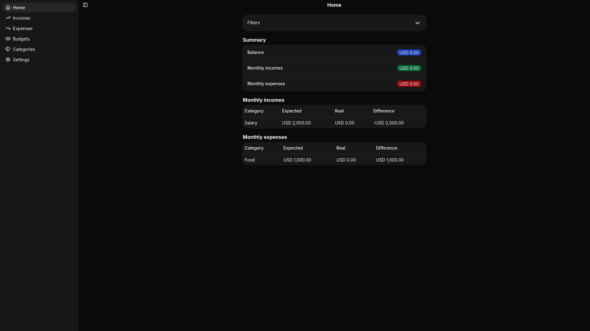
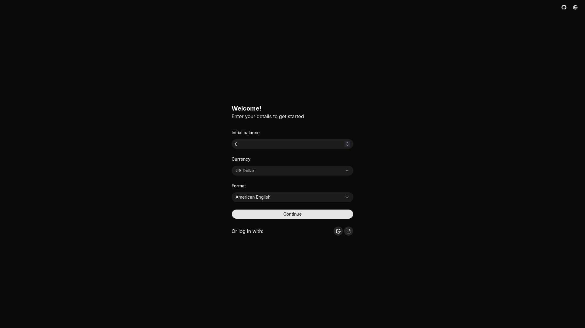

<div align="center">


# Finzen

**Offline-first personal finance app for tracking income, expenses, and monthly budgets, with optional Google Drive backup.**


[**Live Demo**](https://finzenapp.net/app) · [**Repository**](https://github.com/oscar370/finzen) · [**Report a Bug**](https://github.com/oscar370/finzen/issues)

</div>



---

## About the Project

Finzen is a local-first finance tracker. Transactions, categories, budgets, and settings live in your browser's IndexedDB, so the app works without an account or a backend database. An optional Google Drive backup keeps a copy in the app-specific `appDataFolder` and lets you restore it on another device.

Finzen keeps day-to-day finance data on-device instead of handing it to a third-party service, while still providing a practical backup escape hatch.

**Status:** Active

> The live demo stores finance data locally in your browser. Google Drive backup is optional.

## Features

- Record income and expenses with category, date, and note; search and filter by month or category
- Dashboard with balance, monthly income/expenses, and expected-vs-actual per category
- Monthly budgets with expected/actual/difference and optional monthly recurrence
- Custom categories with icons; ten defaults seeded on first run
- 19 currencies, locale-aware formatting, and English/Spanish UI
- Offline-first IndexedDB storage, plus JSON export/import and optional Google Drive backup/restore

<details>
<summary>More screenshots</summary>



</details>

## Tech Stack

| Layer           | Technology                                                  | Why                                                                       |
| --------------- | ----------------------------------------------------------- | ------------------------------------------------------------------------- |
| UI              | React 19 + TanStack Start                                   | Type-safe file routes and search params; client-only routes for IndexedDB |
| Validation      | TypeScript + Valibot                                        | Schemas double as runtime validation and inferred types                   |
| Styling         | Tailwind CSS 4 + shadcn/ui (Base UI)                        | Accessible primitives with themeable design tokens                        |
| Persistence     | Dexie 4 + `dexie-react-hooks`                               | Offline-first IndexedDB with reactive live queries                        |
| i18n            | Paraglide JS (inlang)                                       | Compile-time messages for English and Spanish                             |
| Auth / backup   | Better Auth + Google Drive API                              | Google OAuth and private `appDataFolder` backups                          |
| Tooling / tests | Vite 8, Vitest + `fake-indexeddb`, ESLint, Prettier, devenv | Fast service tests and a reproducible dev shell                           |

## Architecture

<details>
<summary>Project structure</summary>

```
src/
├── routes/       # File routes: /app, /welcome, /sync, /api/auth
├── features/     # Feature UI and page-data helpers
├── services/     # One exported function per file (transactions, budgets, summaries, backup)
├── lib/          # Dexie schema, auth, i18n, errors, utilities
├── components/   # Shared UI (shadcn/Base UI + form inputs)
├── types/        # Valibot schemas and inferred types
├── test/         # Vitest setup and IndexedDB helpers
└── paraglide/    # Generated i18n runtime (do not edit)
messages/         # en.json, es.json
public/           # PWA manifest and icons
```

</details>

## Getting Started

### Prerequisites

- Node.js 22.12+ and pnpm
- _(Optional)_ devenv with direnv
- A Google Cloud OAuth client (only for Google Drive backup)

### Installation

```bash
git clone https://github.com/oscar370/finzen.git
cd finzen
pnpm install
cp .env.example .env
pnpm dev
```

The app runs at `http://localhost:3000`. It works without Google credentials; cloud backup is the only feature that needs them.

**With devenv:**

```bash
direnv allow   # or: devenv shell
pnpm install
pnpm dev
```

### Environment Variables

| Variable               | Description                                                         |
| ---------------------- | ------------------------------------------------------------------- |
| `BETTER_AUTH_SECRET`   | Secret used by Better Auth; generate with `openssl rand -base64 32` |
| `BETTER_AUTH_URL`      | Public app URL, e.g. `http://localhost:3000`                        |
| `GOOGLE_CLIENT_ID`     | Google OAuth client ID                                              |
| `GOOGLE_CLIENT_SECRET` | Google OAuth client secret                                          |

For Google Drive backup, enable the Drive API, add `https://www.googleapis.com/auth/drive.appdata` as an allowed scope, and register `http://localhost:3000/api/auth/callback/google` as an authorized redirect URI. Add the production equivalent (`https://finzenapp.net/api/auth/callback/google`) when deploying.

### Scripts

| Command                  | Description                               |
| ------------------------ | ----------------------------------------- |
| `pnpm dev`               | Start the development server on port 3000 |
| `pnpm build`             | Build for production                      |
| `pnpm preview`           | Preview the production build              |
| `pnpm test`              | Run tests once                            |
| `pnpm test:watch`        | Run tests in watch mode                   |
| `pnpm typecheck`         | Compile i18n messages and run `tsc`       |
| `pnpm lint`              | Run ESLint                                |
| `pnpm format`            | Format with Prettier                      |
| `pnpm check`             | Check formatting                          |
| `pnpm check:i18n`        | Validate translations                     |
| `pnpm compile:i18n`      | Compile Paraglide messages                |
| `pnpm generate-routes`   | Regenerate the TanStack Router route tree |
| `pnpm machine-translate` | Machine-translate missing messages        |

## License

Distributed under the GNU General Public License v3.0. See [`LICENSE`](./LICENSE) for details.
